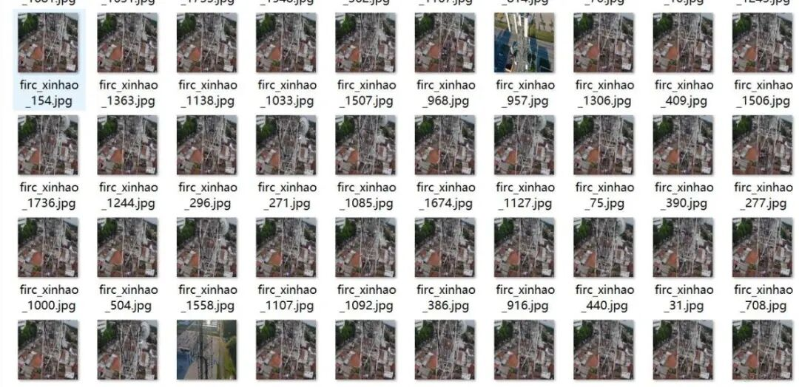
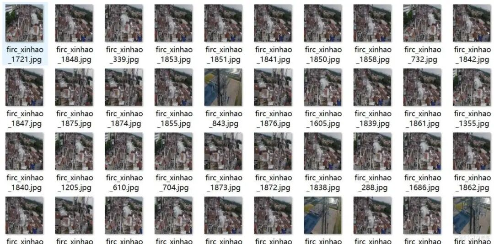
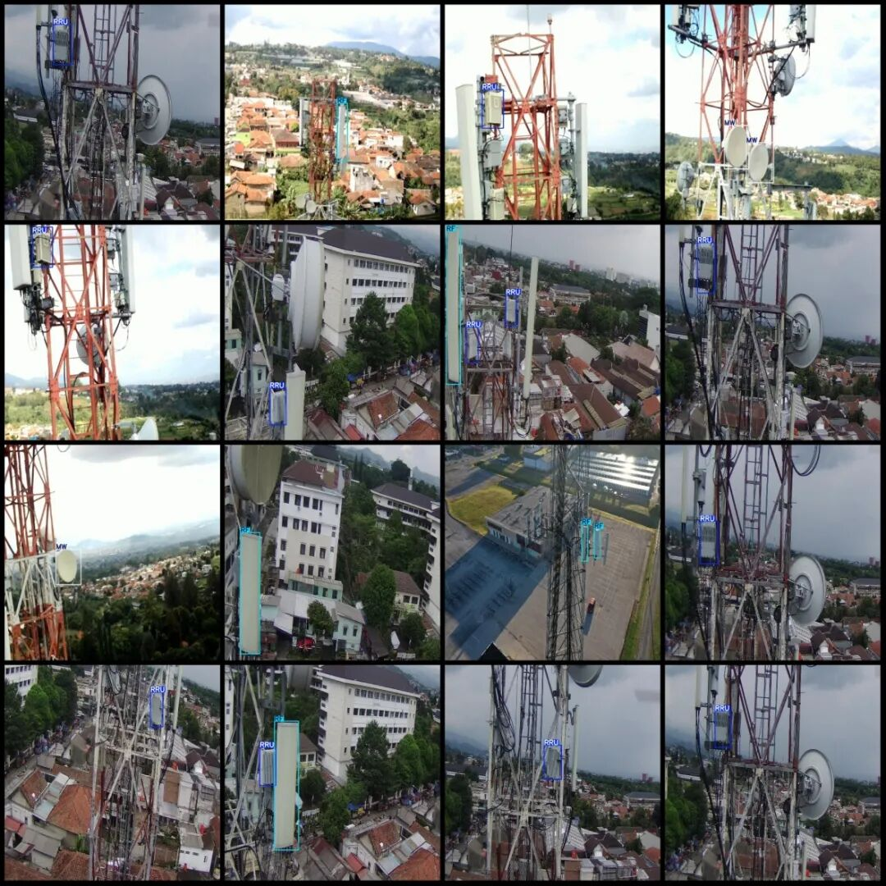

# Dataset for drone signal detection in VOC+YOLO format with 1877 images across 3 categories

Dataset format: Pascal VOC format + YOLO format (txt file without split path, only containing jpg images and corresponding VOC format xml files and yolo format txt files)

Number of images (number of jpg files): 1877

Number of annotations (number of xml files): 1877

Number of annotations (number of txt files): 1877

Label category count: 3

Label category names (Note that the order of categories in the YOLO format does not correspond to this, but is based on the labels folder's classes.txt): ["MW", "RF", "RRU"]

Number of boxes labeled in each category:

MW Frames = 572

RF Frames = 700

RRU Frame Count = 1146

Total frame count: 2418

Image resolution: 1280x1280

Using labelImg:

Annotation rules: Draw a rectangle around the category.

Important Notice: No

Special : This dataset does not guarantee the accuracy of the trained models or weight files.

Drone: DJI mini2

Total memory size: 389M (1877 images)

Image resolution: 1280*1280

Collecting height: 30-60m

Collection angle: 30~60°

Application fields: Used for mobile signal base stations, radio frequency units and other wireless signal devices detection, low altitude target detection and so on.

Image Preview:

Annotation example:

## Payment

Here is a pay link on Stripe ( https://buy.stripe.com/3cs8yP7sY87d0vu9AB ). Please contact me lonlonago@foxmail.com after funding $89, and I will send you a complete data files , thank you!

